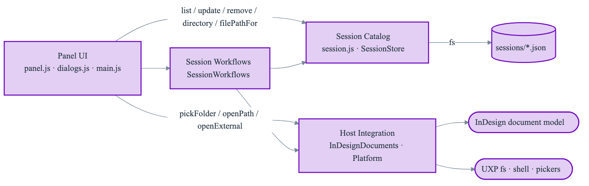
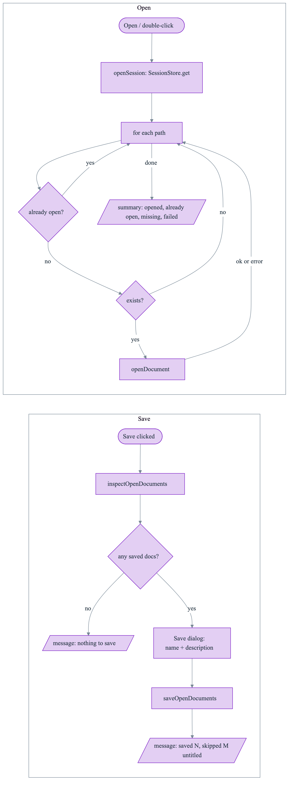

# ADR-001: InDesign UXP Sessions Plugin

**Status**: Accepted
**Date**: 2026-11-08
**Deciders**: Scott Lewis
**Version**: 0.0.3
**Supersedes**: [0.0.2](ADR-001-indesign-uxp-sessions-plugin-0.0.2.md). This version replaces the per-session action bar with a right-click menu on the session list, with the same actions also in the panel menu (approved by the user on 2026-11-08).

## Context

`com.sessions` is a CEP panel for Illustrator (and Photoshop under Rosetta) that saves the file paths of all open documents to a JSON "session" file so a set of working files can be closed and later reopened together. InDesign does not run that panel, and CEP is Adobe's legacy extension platform; InDesign's current platform is UXP (supported since InDesign 18.5).

This ADR defines a UXP plugin for InDesign that provides the same "work session" capability. The CEP code cannot be reused: CEP splits work between a Chromium panel with Node.js and an ExtendScript host, while UXP runs one JavaScript context with its own module set (`indesign`, `uxp`, `fs`, `os`) and no jQuery, CSInterface, `evalScript`, ExtendScript `File`/`Folder`, or ExtendScript `prompt`/`confirm`.

### What the CEP extension does (as built)

| Capability | CEP behavior |
| --- | --- |
| Save session | ExtendScript collects `doc.path + "/" + doc.name` for every open document, prompts for a description, and builds the JSON by string concatenation. The panel adds a UUID, writes `<YYYY-MM-DD>@<epoch>.json` to `<userData>/com.atomic/com.atomic.ai-sessions.panel/data/<host>/`, and creates a symlink per document under `links/<host>/<uuid>/`. |
| List sessions | Globs `data/<host>/*.json`, sorts by reversed slugified filename (newest first while names are dates), shows the date parsed from the filename (or the filename), and shows the description as a tooltip. |
| Open session | Button or double-click sends the file list to ExtendScript, which opens each existing file, skips missing files, and continues past files that fail to open, then runs "fit all". |
| Context menu (right-click a session) | Open Session File (opens the JSON in the OS default app), Copy Session Docs (folder picker, copies each file, overwriting), Rename Session (renames the JSON file, slugified), Add Description, Delete Session (confirm, deletes JSON and links folder). |
| Flyout menu | Collect Open Files (copies open documents to a chosen folder with collision suffix), Open Log File, Documentation, Enable Tooltips toggle, About, Donate, Reload Extension. |

Known defects in the CEP implementation that the new design must not reproduce: a quote character in a description corrupts the session JSON (string-concatenated JSON); renaming a session breaks newest-first ordering (sort key is the filename); session paths are stored in ExtendScript URI form (`~/...%20...`) and need decoding to be used outside ExtendScript; the `links/` symlink folder is written and deleted but never read.

### Platform facts that constrain the design

Verified against Adobe's InDesign UXP documentation (developer.adobe.com/indesign/uxp); items marked (in-host) were confirmed by running UXP scripts in InDesign 21.6 (UXP 9.3.0) on macOS.

- UXP plugins require InDesign 18.5+. Panel flyout menus (`entrypoints.setup({ panels: { <id>: { menuItems, invokeMenu } } })`) require InDesign 20.0+ (UXP 8.0.1).
- `app.documents` is a collection (`length`, `item(i)`). `Document` exposes `name`, `saved`, `modified`, `converted`, `fullName`. (in-host) `fullName` returns a Promise that resolves to a file entry whose `nativePath` is the absolute native path; for a never-saved document, reading it throws "Unsaved documents have no full name."
- (in-host) `app.open(path)` is synchronous, returns the `Document`, and accepts the raw native path string, including names with spaces, `#`, `%`, and non-ASCII characters. Opening a document that is already open returns the existing document without opening a second window. UXP encodes `file:` URLs itself, so callers must not percent-encode paths.
- Reading and writing arbitrary absolute paths requires the manifest permission `localFileSystem: "fullAccess"`. `require("fs")` supports absolute paths. (in-host) `fs.mkdir(path, { recursive: true })` fails with code `-17` when the folder already exists; missing files fail with code `-2`; `fs.rename` replaces an existing target; `fs.copyFile` silently overwrites an existing target unless given the exclusive flag `1` (Node's `COPYFILE_EXCL`), in which case it fails with code `-17`; `fs.writeFile` with `{ flag: "wx" }` likewise refuses to replace an existing file; `fs` has no `appendFileSync` and no `constants`. `require("os").homedir()` returns the user's home directory.
- `localFileSystem.getDataFolder()` resolves to `~/Library/Application Support/Adobe/UXP/PluginsStorage/IDSN/<InDesign version>/<External|Developer>/<plugin id>`; data in it is tied to the InDesign version and differs between developer-loaded and installed builds.
- `alert`/`prompt`/`confirm` are beta in UXP 7.4+ and need a feature flag; the supported way to collect input is the HTML `<dialog>` element with `showModal()`. Folder pickers are available via `localFileSystem.getFolder()`.
- No `contextmenu` event is documented for UXP panels, and UXP offers no native context-menu API for panel content. Pointer events are documented; whether InDesign delivers secondary-button (right-click) pointer events to panel content is confirmed in-host by the user.
- `shell.openPath(path)` / `shell.openExternal(url)` require the `launchProcess` permission and show the user a consent prompt.
- Built-in Spectrum widgets (`sp-button`, `sp-action-button`, `sp-textfield`, `sp-textarea`, `sp-body`, `sp-divider`) need no bundler. InDesign leaves the `--uxp-host-*` theme variables empty; theme via `@media (prefers-color-scheme: ...)` (confirmed by Adobe staff on the UXP developer forum).

## Decision

Build `com.sessions-uxp` as a dependency-free UXP panel plugin for InDesign 20.0+ with four components behind explicit contracts, plain JavaScript (CommonJS, no bundler), built-in Spectrum widgets, and session files stored as one JSON document per session in a stable, version-independent folder.

### 1. Host and platform

- `manifest.json`: `manifestVersion: 5`, `host: { app: "ID", minVersion: "20.0.0" }`, one panel entrypoint.
- Plugin id: `com.atomic.indesign-sessions`. Panel title: "Sessions".
- Permissions: `localFileSystem: "fullAccess"`; `launchProcess: { schemes: ["https"], extensions: ["", ".json"] }` (folders and session files); `network` is not required.

InDesign 20.0 is the minimum because flyout menus are the native place for panel-level commands and they arrive in 20.0. Supporting 18.5–19.x would force every command into panel buttons for versions that are two or more years old.

### 2. Session storage

Sessions are stored in `<appData>/com.atomic/com.atomic.indesign-sessions/sessions/`, where `<appData>` is `~/Library/Application Support` on macOS and `%APPDATA%` on Windows (derived from `os.homedir()` and `os.platform()`). The folder is created on first use.

The UXP data folder is not used because it is scoped per InDesign version and per install type, which would make sessions disappear on each annual InDesign upgrade and hide sessions saved during development from the installed build. `fullAccess` is required anyway to open and copy the user's documents. The `com.atomic/` parent mirrors the CEP extension's convention; the folder is separate from the CEP extension's folder so neither plugin depends on the other's data.

### 3. Session file format

One file per session, named `<id>.json`, written with `JSON.stringify` (2-space indent, UTF-8):

```json
{
  "schemaVersion": 1,
  "id": "20261108-143205-k3f9",
  "name": "2026-11-08 14:32",
  "description": "Spring catalog layout pass",
  "createdAt": "2026-11-08T14:32:05.120Z",
  "updatedAt": "2026-11-08T14:32:05.120Z",
  "files": [
    "/Users/scott/Dropbox/clients/acme/spring-catalog/catalog-2027.indd",
    "/Users/scott/Dropbox/clients/acme/spring-catalog/order-form.indd"
  ]
}
```

- `id` is immutable and derived from the UTC creation time (`YYYYMMDD-HHMMSS`) plus a four-character random suffix; it is the filename. Renaming a session changes `name` only, so no filename sanitization or file renames are needed and rename cannot collide.
- `name` defaults to the local creation date and time and is user-editable. `description` is optional and shown as the row tooltip.
- `files` are native absolute paths in the order InDesign lists the documents.
- The list is sorted newest-first by `createdAt`, independent of `name`.
- The filename stem is the authority for identity. `id` must match `^\d{8}-\d{6}-[a-z0-9]{4}$` and equal the filename stem; `filePathFor(id)` rejects any id that fails the format check, so no store operation can address a path outside the sessions folder. A duplicated or hand-renamed file whose inner `id` does not match its filename is invalid.
- Reading validates the shape: `schemaVersion` known; `id` as above; `name` a non-empty string; `createdAt` (and `updatedAt`, when present) a string that parses as an ISO 8601 date; `description` a string when present; `files` an array of non-empty absolute paths. Invalid or unreadable files are excluded from the list and reported once in the panel's message area; they are never modified or deleted automatically.
- A new session is written with an exclusive create (`wx`) to `<id>.json`; if that id is already taken (two saves in the same second drawing the same suffix), a new id is generated, so creating never replaces an existing session. UXP has no rename that refuses to replace its target, so a create cannot be both exclusive and atomic: a failed write removes its own partial file, and only a crash mid-write can leave a truncated new file, which is listed as invalid and never modified; no existing session is affected.
- Updates go to a temporary file unique to that write, `<id>.json.<unique>.tmp`, and are then renamed over `<id>.json`, so an interrupted write cannot leave a truncated session and two concurrent writers (for example two InDesign instances) cannot publish each other's partial file. Listing reads only `*.json`, so a leftover `.tmp` file is ignored.
- `SessionStore` depends on this subset of the UXP `fs` module, injected so tests can supply a Node-backed fake with the same subset: `mkdir(path, { recursive: true })` (an "already exists" failure is treated as success), `readdir(path)`, `readFile(path, { encoding: "utf-8" })`, `writeFile(path, data, { encoding: "utf-8", flag? })` (`flag: "wx"` for exclusive create), `rename(from, to)` (replacing an existing target), `unlink(path)`. No other `fs` call is used by the catalog.

### 4. Components

| Component | Responsibility | Public contract | Implementation artifacts |
| --- | --- | --- | --- |
| Session Catalog | Own the session record and its persistence: create, validate, serialize, list, read, update, delete. | `SessionStore` with `directory` (absolute sessions folder), `filePathFor(id)`, `list()` → `{ sessions, invalidFiles }`, `get(id)`, `create({ name, description, files })`, `update(id, changes)`, `remove(id)`; `Session` helpers `createSession`, `parseSession`, `sortNewestFirst`. | `src/sessions/session.js` (pure), `src/sessions/SessionStore.js` (uses an injected `fs`-compatible module and directory path), `src/sessions/storageLocation.js` |
| Host Integration | Isolate every call into InDesign and UXP platform services. | `InDesignDocuments` with `listOpenDocuments()` → `{ name, path, modified }[]` (`path` is null for untitled documents) and `openDocument(path)`; `Platform` with `pickFolder()`, `copyFile(src, dest)` (exclusive: fails with an "already exists" error rather than replacing a target), `fileExists(path)` (via `fs.lstat`), `openPath(path)`, `openExternal(url)`. | `src/host/InDesignDocuments.js`, `src/host/Platform.js` |
| Session Workflows | Implement the user-level use cases by coordinating the catalog and host, and return result summaries the UI can display. | `SessionWorkflows` with `inspectOpenDocuments()` → `{ savablePaths, untitledCount, modifiedCount, defaultName }`, `saveOpenDocuments({ name, description })`, `openSession(id)`, `copySessionDocuments(id, folder)`, `collectOpenDocuments(folder)`; pure helper `uniqueTargetName(fileName, isTaken)`. | `src/workflows/SessionWorkflows.js`, `src/workflows/fileNames.js` |
| Panel UI | Render the session list and dialogs, map user gestures and flyout commands to workflows, collect user choices (folder picks, confirmations), and show results. | `index.html` panel and `entrypoints.setup` registration; no contract consumed by other components. | `index.html`, `src/ui/panel.js`, `src/ui/dialogs.js`, `src/ui/contextMenu.js` (right-click menu), `src/ui/messages.js` (result-message formatting), `src/ui/styles.css`, `src/main.js` |

`src/shared/fsErrors.js` is a dependency-free helper outside the four components: it classifies file-system errors from both the UXP `fs` module (numeric codes such as `-2`, `-17`) and Node (`ENOENT`, `EEXIST`). The Session Catalog and Host Integration both use it; it creates no dependency between them and holds no behavior of either.

Dependency direction: Panel UI → Session Workflows → (Session Catalog, Host Integration). The Panel UI also calls two components directly, limited to these operations: `SessionStore` for `list`, `update` (rename, describe), `remove`, `directory`, and `filePathFor`; and `Platform` for `pickFolder`, `openPath`, and `openExternal`. Workflows receive already-chosen inputs (for example the target folder) and never show UI. The Session Catalog and Session Workflows do not import `indesign` or `uxp`; their collaborators are injected, which is what makes them testable outside InDesign.

<!-- diagram: component-overview | Components and dependencies (source: diagrams/component-overview.mmd) -->


Simple record edits and user-interaction platform calls go from the UI straight to their owning component; routing them through the workflows would add a pass-through layer with no behavior. The workflows own only operations with rules: which documents are savable, how a session is opened file by file, and how copies avoid overwriting.

<!-- diagram: save-open-flow | Save and open flows (source: diagrams/save-open-flow.mmd) -->


### 5. Feature disposition

The CEP right-click menu is reproduced as a panel-drawn menu: right-clicking a session selects it and opens a menu at the pointer with **Open, Rename…, Describe…, Copy Files…, Show File, Delete…** (Delete separated by a divider). The menu closes when an item is chosen, on Escape, or on a click outside it. Because native context menus are not available to UXP panels and right-click delivery depends on the host, the same session actions are also listed in the panel flyout menu, where they act on the selected session (and report "Select a session first." when none is selected). Panel-level commands remain in the flyout menu. There is no button row for session actions.

| CEP feature | Disposition | UXP design |
| --- | --- | --- |
| Save session with description prompt | Port | "Save" button opens a dialog with Name (prefilled with date/time) and Description; Cancel aborts. |
| Session list, date label, description tooltip | Port | List rows show name, file count, and created date; `title` tooltip shows the description. Single-select. |
| Open via button and double-click | Port | "Open" button (enabled when a row is selected), row double-click, and "Open" in the session menu. |
| Continue past missing/failing files | Port | Each file is attempted independently; a summary reports opened, already open, missing, and failed counts. |
| Open Session File | Port | "Show File" opens the session JSON with `shell.openPath`. |
| Copy Session Docs | Port | "Copy Files…" picks a folder and copies each existing file; name collisions get a numeric suffix (see edge cases). Afterwards a confirm dialog reports the counts and offers to show the folder (`openPath`), matching CEP's "Open enclosing folder?" prompt. |
| Rename Session | Adapt | "Rename…" edits `name` only; the file is not renamed. |
| Add Description | Port | "Describe…" edits `description`. |
| Delete Session with confirm | Port | "Delete…" shows a confirm dialog, then removes the JSON file. |
| Collect Open Files | Port | Flyout "Collect Open Documents…". Untitled documents are skipped and counted, and documents with unsaved changes are copied in their last-saved state, as stated in the result message (same rules as Save). Same copy rules and same post-copy "show folder" prompt as Copy Files (CEP opened the folder unconditionally; the prompt avoids an unasked-for consent dialog). |
| Documentation link | Port | Flyout "Documentation" opens the repository README URL with `shell.openExternal`. |
| — (new) | Add | Flyout "Show Sessions Folder" opens the storage folder; this replaces the need for a log file to locate data. |
| Open Log File | Drop | UXP plugins log to the UXP Developer Tool console; there is no file logger to open. |
| About / Donate links | Drop | Out of scope for the port; can be added as flyout items later without design changes. |
| Enable Tooltips toggle | Drop | It toggled jQuery UI tooltips; native `title` tooltips are always on. |
| Reload Extension | Drop | The UXP Developer Tool provides reload. |
| `links/` symlink folder | Drop | Written and deleted but never read in CEP; no behavior depends on it. |
| Fit-all after open | Drop | Illustrator/Photoshop view command with no InDesign requirement; InDesign restores each document's saved view. |

### 6. Edge cases

| Case | Behavior |
| --- | --- |
| No documents open on Save | No dialog; message "There are no open documents to save." |
| Untitled (never-saved) documents | Excluded; the result message states how many were skipped. If every open document is untitled, nothing is saved and the message says so. |
| Documents with unsaved changes | The on-disk path is saved; the dialog notes that unsaved changes are not part of a session. |
| Converted documents (opened from an older InDesign version, not yet saved in the new format) | Treated like untitled documents when reading `fullName` fails; otherwise saved by path. |
| A session file already open in InDesign | Skipped and counted as "already open" (paths compared after `path.normalize`-style cleanup of `.`/`..`/trailing separators, case-insensitively on macOS and Windows whose default volumes are case-insensitive). |
| A file that no longer exists | Skipped and counted as "missing"; listed by name in the summary. |
| A file that exists but fails to open | Error caught; counted as "failed"; remaining files still open. |
| Missing-font / missing-link dialogs during open | InDesign's interaction level is not changed, matching CEP: the user sees and resolves those dialogs. |
| Copy / Collect name collision in the target folder | The copy is written as `name (2).ext`, `name (3).ext`, …; existing files are never overwritten, including files copied earlier in the same batch (two sources with the same basename from different folders) and files another process creates after the name was chosen (the copy is exclusive; the next free name is tried). This replaces CEP's inconsistent behavior (overwrite in Copy Session Docs, suffix in Collect). |
| Copy of `.indd` files | Copies the document files only; linked assets and fonts are not included. InDesign's Package command remains the tool for complete hand-off. |
| Folder picker cancelled | No action, no message. |
| Invalid or unreadable session JSON in the folder | Skipped from the list, reported once; never modified. |
| Empty session name on rename/save | Rejected in the dialog (Save button disabled while the trimmed name is empty). |

## Rationale

- One JSON document per session with an immutable id keeps each session independently readable, recoverable, and editable by hand, matches the CEP mental model, and removes the rename and ordering defects at the source.
- A stable storage path outside the version-scoped UXP data folder is the only option that keeps sessions across InDesign upgrades without an export/import feature.
- Four components match the four reasons the plugin changes independently: the session format, the host API, the use-case rules, and the UI. Injecting `fs` and the host into the catalog and workflows confines InDesign-specific uncertainty (for example what `fullName` returns) to one adapter and lets the session and workflow rules be tested in Node.
- No bundler and no runtime dependencies: the plugin is small, the built-in Spectrum widgets cover the UI, and the folder loads directly in the UXP Developer Tool.

## Consequences

### Positive

- Sessions survive InDesign upgrades and are shared between developer and installed builds.
- Quotes, Unicode, and long text in names and descriptions cannot corrupt a session file.
- Host-specific behavior is isolated in `src/host/`; the rest is unit-tested with Jest.

### Negative

- `fullAccess` and `launchProcess` permissions are broad; InDesign shows the user a consent prompt for each `openPath`/`openExternal` call.
- InDesign 18.5–19.x users cannot install the plugin.
- Host behavior cannot be exercised by the Jest suite; it is covered by a separate in-host verification suite that drives InDesign and is run before merge (see the implementation plan).

### Neutral

- Session files from the CEP extension are not imported; the formats and folders are separate.
- Development requires the UXP Developer Tool to load and debug the plugin; distribution is a `.ccx` package produced by that tool.

## Alternatives Considered

### Store sessions in the UXP plugin data folder (`getDataFolder()`)

Requires no path logic, but the folder is scoped by InDesign version and install type, so sessions are lost on upgrade unless the user imports previous settings, and development sessions are invisible to the installed build. Rejected.

### Store all sessions in a single JSON file

Simpler listing, but one corrupted write loses every session, and concurrent edits from two InDesign instances overwrite each other. Rejected in favor of one file per session.

### Use the session name as the filename (CEP approach)

Requires filename sanitization, makes rename a file operation that can collide, and couples display order to the name. Rejected.

### Support InDesign 18.5+

Possible with all commands as panel buttons. Rejected because it gives up the native flyout menu to support versions that are two or more years old.

### React or Spectrum Web Components with a bundler

Adds a build step, npm runtime dependencies, and the `enableSWCSupport` flag for a panel with one list, a small menu, and three dialogs. Rejected.

### Share the CEP extension's data folder (`com.atomic.ai-sessions.panel/data/indesign/`)

Would let one folder hold all hosts, but couples this plugin to another extension's id and to its legacy path format. Rejected.

## Code being removed

The session action bar introduced by v0.0.1 and v0.0.2 (released as v0.1.0):

- `index.html`: the `.actions` element and its five `sp-action-button`s (`rename-button`, `describe-button`, `copy-button`, `show-file-button`, `delete-button`).
- `src/ui/panel.js`: the element references and click bindings for those buttons, and their enable/disable handling.
- `src/ui/styles.css`: the `.actions` rule.

`com.sessions` is not modified by this decision.
