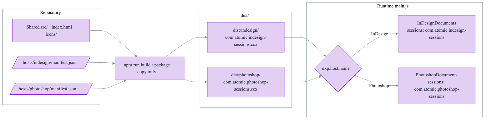

# ADR-002: Photoshop Sessions Plugin

**Status**: Accepted
**Date**: 2026-11-12
**Deciders**: Scott Lewis
**Version**: 0.0.1
**Amends**: [ADR-001 v0.0.3](../ADR-001-indesign-uxp-sessions-plugin/ADR-001-indesign-uxp-sessions-plugin-0.0.3.md) — §1 (host and platform: one manifest, no build step), §2 (storage folder generalized from the InDesign plugin id to the running plugin's id), §4 (Host Integration contract), its Rationale statement that the folder loads directly in the UXP Developer Tool with no build, and its Consequences note that packages come from the UXP Developer Tool. All other ADR-001 decisions — session format, workflows, panel UI, edge cases — apply unchanged to both hosts. ADR-001's text is not revised; its pointer document notes that ADR-002 amends it, and ADR-002 governs wherever the two differ.

## Context

The InDesign Sessions plugin (ADR-001, released as v0.2.0) saves the open documents' paths as a named session and reopens them later. The same capability is wanted in Photoshop. The CEP `com.sessions` extension supported Photoshop only under Rosetta on Apple Silicon; UXP plugins run natively.

ADR-001 isolated every InDesign call in one Host Integration module, `InDesignDocuments` (`listOpenDocuments()`, `openDocument(path)`). Everything else — `SessionStore`, `SessionWorkflows`, the panel, dialogs, the right-click menu, and the `Platform` adapter over UXP `fs`/`shell`/pickers — uses UXP APIs shared by both hosts.

### Platform facts

Marked (in-host) when confirmed by running UXP scripts in Photoshop 27.11 (UXP 9.4.1) and InDesign 21.6 (UXP 9.3.0) on macOS; otherwise from Adobe's UXP documentation and developer forums.

- A packaged plugin (`.ccx`) targets exactly one host. A manifest whose `host` is an array works only for development in the UXP Developer Tool, which packages just the first host, and Adobe's installer agent rejects it. Each host therefore needs its own plugin id and package.
- (in-host) `require("uxp").host.name` is `"InDesign"` in InDesign and `"Photoshop"` in Photoshop.
- (in-host) `require("photoshop").app.documents` has `length` and index access. `Document.path` is a string: the absolute native path for a document on disk, `""` for a never-saved document, and an identifier (not a path) for a cloud document (`cloudDocument === true`). `Document.saved` is `true` for a new untitled document, so it cannot identify unsaved documents. Reading these properties needs no modal scope.
- (in-host) `app.open` rejects a path string ("Parameter must be a valid entry"). It needs a file entry from `localFileSystem.getEntryWithUrl("file:" + nativePath)` — the raw path, not percent-encoded — and must run inside `core.executeAsModal`, otherwise it does nothing. It is asynchronous. Opening a document that is already open returns that document without a second window. `getEntryWithUrl` throws for a missing file; opening a damaged file throws.
- (in-host) UXP `fs` behaves as in InDesign, including the exclusive `copyFile(src, dest, 1)` (fails with code `-17` on an existing target); `os.homedir()` and `os.platform()` work.
- `getEntryWithUrl` requires Photoshop 24.2+. Flyout menus, `<dialog>`, Spectrum widgets, `launchProcess`, and `prefers-color-scheme` are available in Photoshop UXP; Photoshop also populates the `--uxp-host-*` theme variables.
- (in-host) A `.psjs` UXP script launched with `open -a "Adobe Photoshop 2026" script.psjs` runs without a trust prompt, and relative `require` works inside it. Photoshop writes UXP logs to `~/Library/Logs/Adobe/Adobe Photoshop 2026/UXPLogs_*.log`.
- Not yet confirmed: right-click delivery to Photoshop panel content (the flyout menu carries the same session actions), and panel layout under Photoshop 27.x's new UI layer (Adobe asks developers to check for layout shifts).

## Decision

Ship a second plugin, **Sessions for Photoshop**, from the same repository and the same `src/`, with one manifest and one package per host, a copy-only build, and a Photoshop document adapter selected at runtime.

### 1. One repository, one plugin per host

| | InDesign | Photoshop |
| --- | --- | --- |
| Plugin id | `com.atomic.indesign-sessions` (unchanged, so the installed plugin updates in place) | `com.atomic.photoshop-sessions` |
| Manifest | `hosts/indesign/manifest.json`: `host: { app: "ID", minVersion: "20.0.0" }` | `hosts/photoshop/manifest.json`: `host: { app: "PS", minVersion: "26.0.0" }` |
| Panel | `sessionsPanel`, label "Sessions" | `sessionsPanel`, label "Sessions" |
| Permissions | Unchanged | Same as InDesign: `localFileSystem: "fullAccess"`, `launchProcess` (`https`; folders and `.json`) |

Photoshop 26.0 (Photoshop 2025) is the minimum, matching the InDesign 2025 floor; it is above the 24.2 required by `getEntryWithUrl`. Both manifests carry the repository version.

### 2. Copy-only build

`npm run build` assembles `dist/indesign/` and `dist/photoshop/`, each containing that host's `manifest.json` plus the shared `index.html`, `index.js`, `src/`, and `icons/`. `npm run package` zips each folder into `dist/<plugin-id>-<version>.ccx`. `dist/` is ignored by git. The build copies files only — no transpiling or bundling — so the source that runs is the source in `src/`. For development, the UXP Developer Tool loads `dist/<host>/manifest.json` after a build.

### 3. Storage per plugin

The sessions folder becomes `<appData>/com.atomic/<plugin id>/sessions/`. InDesign keeps `com.atomic.indesign-sessions/sessions/`, so existing InDesign sessions are untouched and nothing is migrated. Photoshop uses `com.atomic.photoshop-sessions/sessions/`. Sessions are therefore never shared between hosts, which also prevents opening `.indd` files in Photoshop or images in InDesign. `resolveSessionsLocation` takes the plugin folder name as a parameter; the value is the plugin id from the host table in §5.

### 4. Host Integration: one documents adapter per host

The documents contract becomes:

- `listOpenDocuments()` → `Promise<{ name, path, modified }[]>`, `path` null when the document has no file on disk.
- `openDocument(path)` → `Promise<{ name }>`, rejecting when the host cannot open the file.

`InDesignDocuments` already satisfies it (its synchronous `openDocument` result is awaited the same way). New `PhotoshopDocuments` (`src/host/PhotoshopDocuments.js`):

- Lists `app.documents`; `path` is null when `Document.path` is `""`, when the document is a cloud document, or when the value is not an absolute path (so an unrecognized non-file document is skipped as "not saved to disk yet" instead of failing the whole Save); `modified` is `!saved`.
- Opens one file per call: `getEntryWithUrl("file:" + path)`, then `app.open(entry)` inside `core.executeAsModal` with `interactive: true`, so Photoshop's own open-time prompts (for example a color-profile mismatch or missing fonts) appear and are resolved by the user — the same policy as ADR-001 §6 for InDesign. Whether every such prompt appears inside a plugin's modal scope is confirmed during in-host verification. If `app.open` resolves without a document (for example the user cancels such a prompt), `openDocument` rejects with "not opened", so the file is counted as failed rather than opened. Any failure — missing file, damaged file, or Photoshop already busy in another modal operation — rejects, and the workflow counts that file as failed and continues.

`SessionWorkflows.openSession` awaits `openDocument`, so an asynchronous failure is counted as failed rather than opened.

### 5. Host selection

`src/hosts.js` holds one host table, the single source of each host's plugin id, and a pure `selectHost(hostName, { requireHost })` that returns `{ pluginId, documents }` for the running host. Host modules are obtained only through the injected `requireHost`, so the selection is unit-tested without InDesign or Photoshop, and only the selected host's module is ever required:

| `uxp.host.name` | Plugin id (storage folder) | Documents adapter | Host module |
| --- | --- | --- | --- |
| `InDesign` | `com.atomic.indesign-sessions` | `InDesignDocuments` | `require("indesign").app` |
| `Photoshop` | `com.atomic.photoshop-sessions` | `PhotoshopDocuments` | `require("photoshop")` (`app`, `core`) |

`src/main.js` (the composition root) passes `require("uxp").host.name` and `require` to `selectHost`, then gives the entry's plugin id to `resolveSessionsLocation`. Requiring the other host's module would throw, which is why selection requires lazily. An unrecognized host fails at load with a clear error rather than guessing. Tests assert each mapping (`InDesign` → `InDesignDocuments` and `com.atomic.indesign-sessions`; `Photoshop` → `PhotoshopDocuments` and `com.atomic.photoshop-sessions`), that only the selected host's module is required, that an unknown host throws, and — in the manifest test — that each table entry's plugin id equals the `id` in that host's manifest, so the InDesign entry cannot drift and hide existing sessions. Nothing else in `src/` knows which host it runs in.

<!-- diagram: host-build-layout | Hosts, build, and runtime adapter selection (source: diagrams/host-build-layout.mmd) -->

### 6. Behavior in Photoshop

All ADR-001 behavior applies, with the host's own nouns: Save Session stores the open documents that exist on disk (untitled and cloud documents are skipped and counted as "not saved to disk yet"); Open, the right-click menu, the flyout session commands, Copy Files, Collect Open Documents, Show File, Show Sessions Folder, and Documentation work as in InDesign. If right-clicks do not reach Photoshop panel content, every session action remains available in the flyout menu.

## Rationale

- Adobe's packaging model requires one package and one plugin id per host; sharing `src/` keeps a single implementation of every rule that is not host-specific.
- The documents adapter was the only host-specific seam in ADR-001; adding a second implementation behind the same contract is the change that design anticipated.
- Per-plugin storage keeps InDesign sessions exactly where they are and makes cross-host mix-ups impossible without adding a host field to the session format.
- Runtime selection from `uxp.host.name` avoids generated source files; the build stays a plain copy.

## Consequences

### Positive

- Photoshop gets the same feature set natively on Apple Silicon.
- One code path for sessions, workflows, UI, and tests; host differences live in one adapter each.
- Existing InDesign installs and sessions are unaffected.

### Negative

- A build step is now required before loading the plugin in the UXP Developer Tool or packaging it.
- Two packages to install and version together.
- Right-click delivery and panel layout in Photoshop 27.x need a manual check by the user.

### Neutral

- Photoshop opens each file in its own modal operation; Photoshop may show its usual progress indication while opening.

## Alternatives Considered

### One manifest with `host` as an array

Works in the UXP Developer Tool only; packaging keeps just the first host, and the installer agent rejects it. Rejected.

### A separate repository for Photoshop

Duplicates the session format, store, workflows, UI, and tests, which would then drift. Rejected.

### One shared sessions folder with a host field in each session

Requires a session format change and migration of existing files, and lets a host see sessions it cannot open. Rejected in favor of per-plugin folders.

### Choose the adapter at build time (generated host module)

Adds generated source and makes `src/` differ per package. Runtime selection from `uxp.host.name` is simpler and verified in both hosts. Rejected.

## Code being removed

- Root `manifest.json` — replaced by `hosts/indesign/manifest.json`; the UXP Developer Tool and packaging use `dist/<host>/`.
- The single-host wiring in `src/main.js` (its top-level `require("indesign")`) — replaced by the host table.
- The fixed InDesign folder constant `kPLUGIN_FOLDER` in `src/sessions/storageLocation.js` — replaced by the plugin-folder parameter.
- README instructions that load the repository root in the UXP Developer Tool.

`com.sessions` is not modified by this decision.
